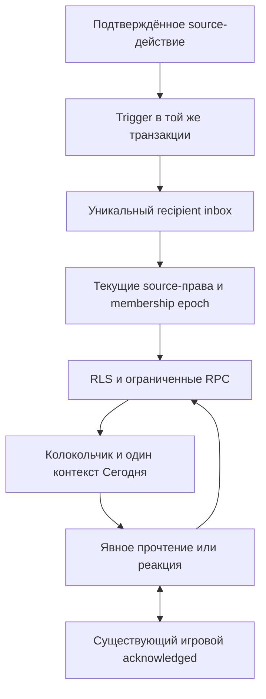

# Живое взаимодействие пары — PR #10

## Аудит и план реализации

База — main после PR #9 (`c8b5473`). Уже существуют `connection_events` (приглашение на конкретную карту, свой acknowledged), `connection_reactions` (только разрешённое shared-настроение), `goal_events` и read-only `statistics_joint_facts`. `useConnection` обновляется раз в 10 секунд, `useCouple` — 15 секунд. Они не являются общим inbox. Не создаём вторую игру/реакции на настроение, не копируем экономические журналы.

План: (1) транзакционный inbox поверх подтверждённых source writes, (2) единый предикат текущего source-доступа для RLS/RPC, (3) серверные read receipts и ограниченные реакции, (4) polling, колокольчик и компактный Today-блок, (5) PostgreSQL/браузерные регрессии и локальные два аккаунта.

Выбранные источники: приглашения/согласия заданий, целей, ритуалов и игры/опросника; собственная отметка партнёра в совместном задании/ритуале; совместное завершение задания/ритуала/цели; готовый взаимно опубликованный разговор; существующее приглашение на карту. Настроение не становится новым источником событий: сам факт приватной записи не должен сообщаться партнёру. Реакции на настроение остаются в исходном модуле.

События без snapshot заголовков и текстов: тип, source UUID/slot, actor/recipient, space и точные membership ID, server timestamp. При чтении проверяются оба исходных активных membership и состояние источника. Ответы доступны только после обеих публикаций; heat/secret требуют текущего opt-in обоих. Close/unpublish/erase/leave немедленно скрывают соответствующие события, включая метаданные при прямом SELECT. Backfill старой истории не выполняется.

Подтверждённое событие пишется trigger-ом в бизнес-транзакции; UNIQUE(source/type/slot/recipient/actor) не допускает повторной доставки. Ошибка/rollback, включая COMMIT failure, откатывает событие. Экономические функции/журналы не меняются. Inbox не является аудитом всех действий: истёкшее/отозванное предложение скрывается, выполненная совместная история остаётся только в исходном составе.

Прочтение отдельно для каждого recipient. Игровой acknowledged двусторонне синхронизирован с inbox; просмотр списка не является прочтением. Переход в source требует подтверждения сервером доступного события и собственной read mutation. Mark all затрагивает только видимые события на сервере, не скрытые строки.

Реакция — одна из четырёх, только адресатом исходного события, без текста, баллов и реакции-на-реакцию. Свою реакцию можно изменить/убрать. Получатель может отключить уведомления о поддержке; безопасность и чтение базовых событий всегда бесплатны. Один notification receipt на event/reactor; изменение/повторное добавление не создаёт новую цепочку. RPC хранит original request UUID+hash payload для безопасного повторения, CAS защищает новое намерение от старой вкладки.

История — серверный live keyset (created_at,id), ограниченная страница, opaque user/epoch-bound cursor с TTL. Это не удерживаемый MVCC snapshot: поздние COMMIT могут потребовать refresh первой страницы. Старый cursor/кэш не используется после смены membership. Polling без Realtime/Push, нет offline-очереди мутаций; reconnect только читает. UI скрывает старые shared данные при ошибке проверки доступа, offline или смене контекста.

Новые уведомления — базовая Free-функция. Будущие Premium 150 грн/месяц на пару и лимиты относятся к PR #15–#16; в этой реализации лимитов/paywall нет. Web/Android Push — отдельный PR #13.

## Реализованная схема и API

Migration: `supabase/migrations/20261024120000_couple_activity.sql`. Старые миграции не изменяются.

- `couple_activity_events` — recipient-scoped envelope, уникальный `(kind, source_id, slot, actor_id, recipient_id)`. `read_at` принадлежит только получателю. Никаких пользовательских текстов/ответов в сохранённом payload.
- `couple_activity_reactions` — одна текущая реакция получателя на событие; `couple_activity_requests` — hash original intent для идемпотентного replay. Нет свободного текста, пользовательских timestamps, сумм или наград.
- `couple_activity_preferences` — личная настройка уведомлений о реакциях, сохраняется при смене пары. Отключение скрывает и существующие support notifications. Повторное включение не создаёт backfill; если прежнее событие осталось, его `read_at` сохранён. Отправитель может сохранить свой выбор, но отключивший уведомления партнёр не получает поддержку в inbox.
- `couple_activity_cursors` — закрытые от REST технические курсоры. TTL 30 минут, максимум 100 на пользователя; пользователь/epoch/ceiling/last tuple хранятся сервером. Страница 20, допустимый серверный limit 1–50, клиент держит не более пяти страниц; глубокая история доступна дальнейшим «Раніші події». «Оновити список» возвращает к новым событиям. Late COMMIT — refresh, не обещание строгого snapshot.

Публичные RPC (только authenticated с verified-account check): `activity_summary()`, `list_couple_activity(uuid,integer)`, `read_couple_activity(uuid)`, `set_activity_reaction(uuid,text,text,uuid)`, `set_activity_preferences(boolean)`. `activity_event_visible(uuid)` — узкий boolean-предикат RLS, проверяет только доступ адресата. Все SECURITY DEFINER имеют `search_path=''`. `activity_emit`, `activity_from_source`, `activity_sync_read`, `activity_subject` и `activity_source_visible` недоступны anon/authenticated. Прямая запись запрещена во все пять таблиц, технические курсоры/request journal нельзя читать через REST.

`activity_subject` читает текущее разрешённое название задания/цели/ритуала, не сохранённый снимок. Игра показывает только название модуля, никогда вопрос/ответ/настроение. При удалении исходного объекта строки inbox остаются техническими envelope, но исчезают из SELECT/RPC и unread count. После leave это верно для обеих сторон и всех read/reaction receipts; ни UUID, ни время, ни название не передаются новому составу. Повторное вступление той же учётной записи не восстанавливает доступ. Физическое удаление Auth user/space выполняет FK cascade; данная миграция не удаляет старые данные.

Trigger-источники: `task_participants`, `task_completions`, `task_instances.status`, `goal_consents`, `couple_goals.status`, `ritual_consents`, `ritual_completions`, `ritual_instances.status`, `connection_sessions`, `connection_answers`, `connection_events`. Частичная отметка скрывается после полного завершения/истечения; declined/withdrawn/void consents не показываются. Нет уведомлений о пропусках, бездействии, личных заданиях или mood writes. Обе стороны получают совместный итог, только другой участник — частичную отметку.

У существующего `connection_read('home')` дополнительно ограничена проекция приглашений текущим status и consent категорий: закрытая игра/opt-out не оставляет чувствительный факт в старом Today hero. Остальные ветки сохранены. Новые события о готовом ответе требуют обеих действующих публикаций (даже для автора одного ответа); own-answer exception исходной RLS здесь не используется. `read_couple_activity` для game notify синхронизирует старый acknowledged, а естественный visible-card ack синхронизирует inbox. Mark all не помечает скрытые события.

## Клиент и новые сценарии

1. Колокольчик → `/activity`: Today/Yesterday/Earlier по локальному календарю устройства, unread dot и до `99+` в индикаторе. Открытие списка само ничего не помечает; «Прочитано», «Прочитати всі» или переход в источник — явные read RPC.
2. Переход получает ссылку от сервера после повторной авторизации. Закрытая/отозванная сущность не открывается по устаревшему событию. Источник повторно проверяет доступ собственным RPC/RLS.
3. Одна реакция: нажать выбранную ещё раз, чтобы убрать; выбрать другую, чтобы заменить. Нет reaction-on-reaction. Изменения/повторная отправка не создают новую notification chain.
4. Если ответ потерян, хранится UUID+исходный expected/payload. «Перевірити події» только читает; retry отправляет тот же intent. Даже при недоступном sessionStorage память query cache сохраняет intent между remount/offline; full reload без storage теряет локальную попытку, но state-setting RPC, CAS и уникальный notification key не допускают двойную доставку. Новый выбор — отдельное действие, исходный retry не перебазируется. Никаких offline mutations/reconnect writes.
5. На Сегодня максимум один дополнительный контекст, согласия goal/ritual выше информационных. Game invite/notify и task proposal не повторяют существующий главный hero. Пустой блок отсутствует, искусственного CTA нет.
6. Настройка реакций — меню событий. В demo только объяснение и вход в «Мы», нет фиктивного сохранения/доставки/баланса.

Polling: summary 10 секунд, открытые страницы 15 секунд, без фонового polling; membership уже проверяется существующим `useCouple`. На смену epoch ключи меняются, join/leave очищают activity cache. Ошибка доступа/offline скрывает прошлые данные; во время повторной проверки они не показываются. Доступ не является push-синхронным: факт, уже показанный до отзыва на другом устройстве, невозможно «разувидеть»; актуальность ограничена polling. Этот модуль не обещает realtime revocation.

## Ручная проверка двумя аккаунтами

Используйте только собственную отдельную локальную/тестовую пару, не существующие облачные аккаунты.

1. Авторизовать A/B, создать пространство/принять приглашение. A предлагает совместное дело → у B колокольчик и событие с названием. A не видит чужой inbox по UUID.
2. B реагирует, меняет и убирает реакцию. A получает только одну support notification; после удаления она скрыта. Отключить уведомления в настройках A → поддержки нет, базовые согласия остаются.
3. B читает событие → A не теряет свой unread. B открывает дело и принимает. Согласие исчезает. A отмечает собственную часть → B видит тёплый частичный статус. B завершает свою часть → у обоих один совместный итог, прежние балансы начисляются как прежде.
4. Запустить игру, A сохраняет/публикует ответ. У B не должно быть answer-ready события до собственной публикации/пропуска. Затем оно доступно, без текста ответа в центре событий. Приглашение на карту прочитать непосредственно в игре → badge inbox обновится; обратный путь также работает.
5. Закрыть/unpublish/удалить ответы или отозвать heat/secret → старые связанные уведомления и реакции исчезают с обеих сторон. Проверить RPC и прямой SELECT. То же после выхода, возвращения того же пользователя и нового партнёра.
6. Потерять связь во время реакции, восстановить сеть: новая мутация сама не выполняется. Проверить/повторить исходный выбор. Открыть две вкладки и выбрать разные реакции из одного исходного состояния: CAS разрешит только одну.
7. Создать >20 событий, пролистать историю; refresh вернёт к новым. Проверить 360/390/1280, обе темы, Tab/Enter/Space/Escape, reduced motion.

## Локальные автоматические проверки

`npm test` включает PostgreSQL security/RPC/atomicity и UI/unit; `npm run test:browser` — демо и регрессии PR9 в Chromium/WebKit. Для реальных сессий:

1. Создать свой disposable local Supabase, получить status JSON в `/tmp` (не в Git).
2. `npm run test:supabase -- /tmp/OWN-status.json`: настоящие Auth/PKCE/JWT/PostgREST/RLS, миграции и старые бизнес-регрессии. Скрипт принимает только loopback, создаёт/удаляет только свои аккаунты.
3. Собрать приложение с **публичными локальными** VITE env, запустить preview 4174. Service-role не передавать Vite.
4. `KOLO_ACTIVITY_STATUS_FILE=/tmp/OWN-status.json npm run test:activity-browser`: оба движка, реальные два пользователя и source RPC, read/reactions, offline/reconnect, privacy, Axe и mobile/desktop screenshots. `npm run test:connection-accounts -- /tmp/OWN-status.json http://127.0.0.1:4174` дополнительно проверяет исходные game states/конкурентный next/receipt/leave в Chromium.
5. Восстановить демо build для обычного browser suite на 4173. Удалить временный status JSON и остановить собственный стек.

Скриншоты содержат только новые синтетические локальные факты (без имён/адресов аккаунтов): [mobile light](screenshots/pr10/inbox-webkit-390-light.png), [mobile dark](screenshots/pr10/inbox-webkit-390-dark.png), [desktop light](screenshots/pr10/inbox-webkit-1280-light.png), [desktop dark](screenshots/pr10/inbox-webkit-1280-dark.png). Аналогичные Chromium-снимки находятся рядом.

## Порядок применения (только вручную после review)

Backup → локальная проверка всех миграций/тестов → отдельно одобренное применение `20261024120000_couple_activity.sql` → frontend. Миграция транзакционная и не backfill-ит уведомления о прошлых действиях. Старые source/RPC/economy migrations не переписываются. Новых env/Dashboard services/Realtime publications не требуется; только текущие Supabase URL/public key. До миграции новый центр покажет безопасную ошибку, существующие функции продолжают работать. Rollback фронтенда возможен без удаления данных; для SQL не удаляйте ledger/source tables, подготовьте отдельную review migration при необходимости.

## Проверки реализации и оставшиеся ограничения

Подтверждённая регрессия прежнего read model: `connection_read('home')` возвращал metadata игрового приглашения после close. PostgreSQL-тест временно устанавливает прежнюю read-функцию на disposable БД и воспроизводит результат, затем восстанавливает новую и проверяет отсутствие события. Это отдельное подтверждённое исправление, а не предположение по интерфейсу.

Новые защитные проверки: direct RLS/RPC после leave/rejoin/нового партнёра, скрытые ответы до взаимной публикации, opt-out heat/secret, close/unpublish/erase/delete, раздельное прочтение и bridge ack, одинаковые UUID/CAS, конкурентные отметки/реакции/leave, deferred COMMIT rollback, expiry старых partial без materialization, cursor actor/epoch/TTL и сортировка одинаковых timestamps. Существующие задачи, цели, reward store, XP/Coins, ритуалы, статистика и PR9 visual snapshots входят в регрессионные наборы.

Axe обнаружил некорректный aria-label у декоративного unread span — добавлена корректная роль. В реальном локальном smoke подтверждена асинхронность PostgREST schema cache: ожидание готовности теперь проверяет read-only таблицы вместе с RPC, не повторяет бизнес-мутацию. Эти изменения относятся к проверенной реализации/тестовому запуску.

- Список источников намеренно ограничен перечисленным whitelist. Покупки/награды, mood и achievements не создают дополнительный inbox в этом этапе; их существующий UI/логика сохранены. Добавление источников — только после проверки их собственной приватности.
- Polling, не Push/Realtime: обновления не мгновенны. История live keyset, не строгий snapshot. Старые действия до миграции не backfill-ятся.
- Request journal сохраняется для replay; автоматическое удаление истории/retention не добавлено. При масштабировании нужен отдельный план хранения без нарушения идемпотентности.
- Локальный Supabase — PostgreSQL/Auth/PostgREST/Kong/Mailpit; Storage/Realtime/Edge не использовались. CLI в sandbox потребовал ignore-health-check для ошибочного healthcheck контейнера Auth; настоящие email/Auth/JWT/RPC и cleanup проверены SDK.
- WebKit — настоящий Linux engine с локально распакованными shared libraries. Пропущено только обнаружение системных пакетов (`PLAYWRIGHT_SKIP_VALIDATE_HOST_REQUIREMENTS=1`), не сами тесты. Физический iPhone и ручной screen reader не проверялись; Axe, keyboard/focus и reduced motion проверены.
- Vite сохраняет предупреждение >500kB основного bundle (около 989kB / 279kB gzip). Новый тяжёлый realtime SDK не добавлен; code splitting остаётся отдельным улучшением.

### Итог проверок

| Команда / сценарий | Результат |
|---|---|
| `npm run typecheck`, `npm run lint` | PASS |
| `npm test` | PASS: catalog checker, 163 UI/unit, 145 PostgreSQL security/RPC + 6 migration/backfill |
| `npm run test:browser` | PASS 14/14, Chromium/WebKit, demo и PR9 regressions |
| `npm run test:activity-browser` с собственным local status | PASS 2/2 реальных двухаккаунтных сценария (Chromium/WebKit), 360/390/1280, обе темы, keyboard/Axe, offline/reconnect и privacy |
| `npm run test:connection-accounts` | PASS, исходный реальный игровой сценарий, конкурентный next, storage loss/reload, visible receipt, новый inbox/reaction/offline/leave |
| `npm run test:supabase` после свежего local reset | PASS, реальные Auth/email/PKCE/JWT/PostgREST/RLS/RPC и сохранность прежней экономики |
| `npm run build` | PASS, существующее предупреждение о размере основного chunk |

Удалённые SQL, production deploy и merge не выполнялись. Все созданные скриптами временные Auth-аккаунты — локальные, очищены после проверки.
